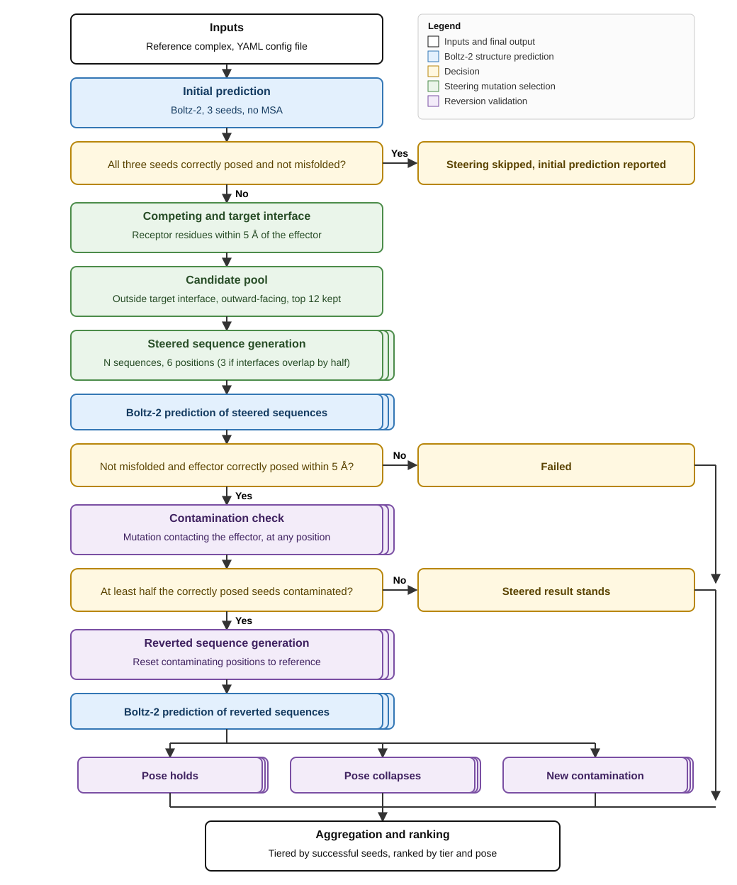

# structure-negative-steering 

[](https://github.com/joshuandwilliams/structure-negative-steering/actions/workflows/test.yml)
[](https://github.com/joshuandwilliams/structure-negative-steering/actions/workflows/lint.yml)
[](https://app.codecov.io/gh/joshuandwilliams/structure-negative-steering)


Boltz-2 sometimes docks a receptor and its binding partner at the wrong
interface, and repeating the prediction returns the same wrong answer. Negative
steering mutates the receptor surface residues the prediction wrongly puts in
contact, so the model can no longer settle there. The interface you intend to
keep is protected from mutation, so what the method removes is a competing site
rather than the intended one.

It never says where the partner should bind. It says where it should not.

This repository holds the engine, the Nextflow workflow that runs it on a
cluster, and the analyses behind Chapter 4 of the thesis.



## Results

The benchmark is 18 solved complexes, each an integrated HMA decoy domain
(Pikp, Pikm, RGA5-HMA) bound to an AVR effector. A pose counts as correct when
the receptor-aligned effector RMSD is under 5 Å, scored on the median of three
seeds.

| Method | Correctly posed |
|:---|---:|
| Boltz-2, no MSA | 5 / 18 |
| Boltz-2 with reference restraints | 13 / 18 |
| Boltz-2 with negative steering, 50 sets | 15 / 18 |
| Both together, 20 sets | 18 / 18 |

Accuracy climbs with the number of steering mutation sets sampled, so the count
is a cost decision rather than a fixed requirement.

| Steering sets | 0 | 3 | 5 | 10 | 20 | 50 |
|---|---:|---:|---:|---:|---:|---:|
| Correctly posed | 4 | 9 | 9 | 11 | 13 | 15 |

Reference restraints are a ceiling, not a rival method. They are derived from
the solved structure, so they cannot run on a novel target. They are here to
show the failures are not intrinsic to Boltz-2.

The 18/18 row carries that caveat twice over. It hands the model the interface
through the restraints and through the protected set. `experiments/interface-ablation/`
is the control for it. That arm permutes the receptor's interface residues at
fixed composition, so a pose still landing inside the threshold is a false
positive by construction.

## Installation

The analyses and the tests run on a laptop. No predictor is installed, by
design: Boltz-2 and its CUDA stack live in the Singularity image built from
`containers/boltz2_negsteer.def`, on the cluster.

```bash
mamba env create -f environment.yml
mamba activate negsteer-analysis
```

Quarto is not a conda package here. Install it separately and keep it at
1.9.38, the version the committed HTML was rendered with. Figures only
regenerate byte-identically under the pinned matplotlib, so use this
environment rather than a pip virtualenv for anything that writes one.

## Running it

One target is one `config.yml`. On the cluster, one `sbatch` runs the whole
thing and nothing is left on the login node.

```bash
./scripts/sync_to_hpc.sh                   # from the Mac

# on the HPC, from the repo root
sbatch scripts/run_workflow.slurm.sh experiments/benchmarking/unconstrained/6G10/config.yml
sbatch scripts/run_workflow.slurm.sh 'experiments/benchmarking/**/config.yml'
sbatch scripts/run_dose_sweep.slurm.sh     # all five doses, one head job
```

`-resume` is always passed, so a head job that hits its walltime can be
resubmitted with the identical command and skips what already finished.

To walk the whole DAG on a laptop with no container and no GPU:

```bash
nextflow run main.nf -profile local --targets 'tests/test_run/config.yml' -stub-run
```

## Using it as a tool

`negsteer` is the interface another pipeline calls, in the same way it calls
RFDiffusion or ProteinMPNN. One command, one run directory.

```bash
singularity exec --nv negsteer.img negsteer run \
    --name            design_00 \
    --receptor-fasta  receptor.fasta \
    --effector-fasta  effector.fasta \
    --reference-pdb   complex.pdb \
    --design-region   design_region.txt \
    --true-interface  true_interface.txt \
    --outdir          design_00
```

Read `negsteer_result.json` rather than globbing the directory. It names every
output and carries a `contract_version` to pin against. Files it does not name
are internals and may move.

The CLI runs the same nine stages, in the same order, with the same arguments
as the shell runner that produced the committed benchmark.
`tests/characterization/test_negsteer_cli.py` asserts that equivalence, so the
tool and the numbers cannot drift apart.

## What is here

| Path | Contents |
|:---|:---|
| `main.nf`, `modules/` | The workflow. Wiring only, one process per stage |
| `bin/` | The engine, and its import closure |
| `negsteer/` | The `negsteer` CLI |
| `scripts/` | Cluster launchers, config generators, HPC sync |
| `data/reference_complexes/` | The 18 solved complexes, one copy each |
| `experiments/` | Run definitions. Outputs are HPC-authoritative and gitignored |
| `analysis/` | One folder per analysis document, with its own figures |
| `containers/` | Singularity definitions. The images live on the cluster |
| `tests/` | The suite, plus its cluster wrappers |

Every config in every tree points at `data/reference_complexes/`, so no two
arms can disagree about what truth is.

## Analyses

Nine Quarto documents, numbered in the order Chapter 4 uses them. Each folder
carries its own `.qmd`, figures, and the data it owns, so a figure's provenance
is its directory. Rendered HTML is a build artefact and is gitignored.

| Document | Asks |
|:---|:---|
| `01-pose-rescue` | does steering rescue the pose |
| `02-model-choice` | steering against reference restraints |
| `03-compute-cost` | what a steering run costs |
| `04-confidence-cost` | does steering cost confidence |
| `05-campaign-confidence` | the same question on a design campaign |
| `06-confidence-synthesis` | the two confidence results together |
| `07-ipsae-instability` | whether ipSAE ranks reliably at this scale |
| `08-tier-failure-breakdown` | how often each complex is corrected, and how it fails |
| `09-mutation-excluded-ipsae` | ipSAE with the steering mutations excluded |

To regenerate, pull the summaries down from the cluster (about 16 MB, no raw
model outputs) and re-render:

```bash
scripts/sync_from_hpc.sh --name benchmarking --results-only
cd analysis/01-pose-rescue && quarto render 01-pose-rescue.qmd
```

Every analysis falls back to its committed cached table when the run tree is
absent, so all of them re-render anywhere.

## Tests

Two tiers. A marker says what a test needs, not where it happens to run.

| Tier | Needs |
|:---|:---|
| `logic` | Python and the `test` extra |
| `check_test_run` | the output of a real run on disk |

```bash
pytest -m logic                  # everything that needs no run
sbatch tests/test_run.slurm.sh   # produce a fresh run, then assert on it
```

Coverage is gated as a ratchet that may only rise. The badge above is the live
number.

## Status

The benchmark is complete and the committed analyses are current. Every
analysis renders, and every committed CSV and figure regenerates from the
pinned environment.

Two things were known to be wrong. Both are now fixed, and both are recorded
here because the first one changes what a new run does.

**The effector template did not reach Boltz, and now does.**
`write_boltz_yaml` used to emit the `templates:` block inside the effector's
chain entry. Boltz reads `templates` only from the root of the schema, at
`boltz 2.2.1 data/parse/schema.py:1603`, and a chain entry is inspected only
for the key naming its entity type, at `schema.py:1018-1020`, so the nested
block was dropped without an error. Boltz's own record of a run says so: the
committed fixtures at
`tests/characterization/fixtures/single_run/*/boltz_results_input/processed/records/input.json`
both carry `"templates": []`. Paired template and template-free runs in
`structure-prediction-benchmarking` returning byte-identical structures for
every seed is what prompted the check.

The block is now a root key. `force: true` makes the template a steering
potential during diffusion, and `threshold` is then the flat-bottom upper
bound in angstroms on each templated CB's deviation from the rigidly aligned
template position (`boltz 2.2.1 model/potentials/potentials.py:599-641`). The
default threshold is 1.0 Å. `tests/characterization/test_boltz_yaml_schema.py`
pins the placement, because a regression would again be silent at run time.

**Every prediction in `experiments/` was made before this fix**, so a rerun
will not reproduce the committed numbers. They remain the published ones.
Reproducing them means passing `--no-effector-template`, which is what those
runs effectively did.

**Half the committed results were produced by the workflow.** The earlier claim
that all of them predate it was wrong.

| cohort | runner | committed outputs |
|:---|:---|:---|
| `experiments/dose-sweep/` (90 target × dose units) | the Nextflow workflow, head job `nf_dosesweep` | the pose-rescue figures and `n50_pose_metrics.csv`, `dockq_scores.csv`, `dose_sweep_pass_counts.csv`, `dose_sweep_maxrss.csv`, `tier_failure_breakdown_n50.csv`, and the steered series in `02-model-choice` |
| `experiments/benchmarking/` (18 targets × 2 arms) | the single-job runner, one `sbatch` per target | `benchmark_summary.csv`, `negsteer_maxrss.csv`, `confidence_per_prediction*.csv` |
| the `pikp1_avrpikf` design campaign | `receptor-resurfacing-pipeline`, not this repo | `campaign_data/*.csv`, `sequence_match.csv`, `ipsae_*.csv`, `mutation_excluded_*.csv` |

The provenance of each memory figure is recorded at
`analysis/03-compute-cost/stage_runtime_comparison.py:106-122`, which is where
the split is visible: the dose-sweep cohort's peak memory comes from a Nextflow
trace, the 18-target cohort's from Slurm `MaxRSS` because those jobs produced
no trace.

## Further reading

[`docs/implementation-notes.md`](docs/implementation-notes.md) carries the
engineering detail. Why every process declares a `path` output, how resume
semantics work, the Nextflow profile trap that cost a run, the dose sweep's
sizing table, and the per-analysis reproduction notes.

## Citing

See [`CITATION.cff`](CITATION.cff). `bin/` and `modules/` began as a copy of
[`receptor-resurfacing-pipeline`](https://github.com/joshuandwilliams/receptor-resurfacing-pipeline)'s
negative-steering entry points and have since diverged. They are this
repository's code now.
