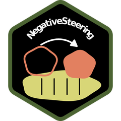

# structure-negative-steering 

[](https://github.com/joshuandwilliams/structure-negative-steering/actions/workflows/test.yml)
[](https://github.com/joshuandwilliams/structure-negative-steering/actions/workflows/lint.yml)
[](https://app.codecov.io/gh/joshuandwilliams/structure-negative-steering)


Boltz-2 sometimes docks a receptor and its binding partner at the wrong
interface, and repeating the prediction returns the same wrong answer. Negative
steering mutates the receptor surface residues the prediction wrongly puts in
contact, so the model can no longer settle there. The interface you intend to
keep is protected from mutation, so what the method removes is a competing site
rather than the intended one.

It never says where the partner should bind. It says where it should not.

This repository holds the engine, the `negsteer` command another pipeline
calls, and the Nextflow workflow that runs it on a cluster. The benchmark that
measured it, its run definitions and the analysis documents are in
[`negative-steering-analyses`](https://github.com/joshuandwilliams/negative-steering-analyses).


## Results

Measured on 18 solved complexes, each an integrated HMA decoy domain (Pikp,
Pikm, RGA5-HMA) bound to an AVR effector. A pose counts as correct when the
receptor-aligned effector RMSD is under 5 Å, scored on the median of three
seeds. The runs, the tables behind these counts and the nine analysis
documents are in
[`negative-steering-analyses`](https://github.com/joshuandwilliams/negative-steering-analyses).

| Method | Correctly posed |
|:---|---:|
| Boltz-2, no MSA | 5 / 18 |
| Boltz-2 with reference restraints | 13 / 18 |
| Boltz-2 with negative steering, 50 sets | 15 / 18 |
| Both together, 20 sets | 18 / 18 |

Accuracy climbs with the number of steering mutation sets sampled, so the count
is a cost decision rather than a fixed requirement.

| Steering sets | 0 | 3 | 5 | 10 | 20 | 50 |
|---|---:|---:|---:|---:|---:|---:|
| Correctly posed | 4 | 9 | 9 | 11 | 13 | 15 |

Reference restraints are a ceiling, not a rival method. They are derived from
the solved structure, so they cannot run on a novel target. They are here to
show the failures are not intrinsic to Boltz-2.

The 18/18 row carries that caveat twice over. It hands the model the interface
through the restraints and through the protected set. The interface-ablation
arm in the analyses repository is the control for it. It permutes the
receptor's interface residues at fixed composition, so a pose still landing
inside the threshold is a false positive by construction.

## Installation

The config driver, input preparation and the tests run on a laptop. No
predictor is installed, by design: Boltz-2 and its CUDA stack live in the
Singularity image built from `containers/Dockerfile`, on the cluster.

```bash
pip install -e '.[runtime]'          # numpy, gemmi, biopython, PyYAML
pip install -e '.[test]'             # the same, plus pytest
pip install -e '.[dev]'              # the same, plus the pinned ruff
```

There is no conda environment here. The pinned analysis stack, which is what
regenerates a committed figure byte for byte, belongs with the analyses in
[`negative-steering-analyses`](https://github.com/joshuandwilliams/negative-steering-analyses).

### Your cluster

Nothing in this repo names a partition, a container path or an email address.
Everything that would is in one file:

```bash
cp site.conf.example site.conf    # then fill in the partitions and the image
```

`site.conf` is gitignored and `site.conf.example` documents every setting.
Every one is optional. The minimum for a real run is `NEGSTEER_BOLTZ_IMG`,
which is the Singularity image, and `NEGSTEER_PARTITION_GPU`. Without a
partition the jobs take your cluster's default, which is right for the
Nextflow head process and usually wrong for the Boltz calls.

Two settings matter when your targets live in their own repository rather than
under this checkout. `NEGSTEER_REPO_DIR` names this engine, and
`NEGSTEER_BIND_PATHS` names any directory the containers must also see, such as
a `data/` tree holding reference structures. Every stage binds the engine so it
can run `bin/`, and a container sees nothing else unless it is bound.

## Running it

One target is one `config.yml`. On the cluster, one submission runs the whole
thing and nothing is left on the login node.

```bash
# on the HPC, from the repo root
./scripts/submit.sh workflow tests/test_run/config.yml
./scripts/submit.sh workflow 'my_targets/**/config.yml'
```

`submit.sh` is a thin wrapper that adds this site's partition and accounting
from `site.conf`. It is not required. `sbatch scripts/run_workflow.slurm.sh
<targets>` works too, and `--dry-run` prints the command rather than
submitting it.

`--targets` resolves against the directory you submit from, and each target's
derived `inputs/` and `run/` tree is written beside its own `config.yml`. So a
project keeps its targets in its own repository and submits from there, with
`NEGSTEER_REPO_DIR` pointing at this one:

```bash
cd ~/my-project
NEGSTEER_REPO_DIR=~/structure-negative-steering \
    sbatch ~/structure-negative-steering/scripts/run_workflow.slurm.sh \
    'targets/**/config.yml'
```

`-resume` is always passed, so a head job that hits its walltime can be
resubmitted with the identical command and skips what already finished.

To walk the whole DAG on a laptop with no container and no GPU:

```bash
nextflow run main.nf -profile local --targets 'tests/test_run/config.yml' -stub-run
```

## Using it as a tool

`negsteer` is the interface another pipeline calls, in the same way it calls
RFDiffusion or ProteinMPNN. One command, one run directory.

```bash
singularity exec --nv negsteer.img negsteer run \
    --name            design_00 \
    --receptor-fasta  receptor.fasta \
    --effector-fasta  effector.fasta \
    --reference-pdb   complex.pdb \
    --design-region   design_region.txt \
    --true-interface  true_interface.txt \
    --outdir          design_00
```

Read `negsteer_result.json` rather than globbing the directory. It names every
output and carries a `contract_version` to pin against. Files it does not name
are internals and may move.

The CLI runs the same stages, in the same order, with the same arguments as
the shell runner that produced the committed benchmark. Thirteen invocations
always run, plus one per steered design and one per reversion.
`tests/characterization/test_negsteer_cli.py` pins that list and asserts the
equivalence, so the tool and the numbers cannot drift apart.

## What is here

| Path | Contents |
|:---|:---|
| `main.nf`, `modules/` | The workflow. Wiring only, one process per stage |
| `bin/` | The engine. Everything a workflow stage runs |
| `negsteer/` | The `negsteer` CLI |
| `scripts/` | What you run: the cluster launchers |
| `site.conf.example` | Every setting that is specific to one cluster |
| `data/reference_complexes/` | Two solved complexes, 6G10 and 7QZD, used as test fixtures |
| `containers/` | Two Dockerfiles, runtime and test. The images live on the cluster |
| `tests/` | The suite, plus its cluster wrappers |

`data/reference_complexes/` holds only what the tests read. The 18 benchmark
complexes live in the analyses repository, beside the configs that point at
them, so no two arms there can disagree about what truth is.

## Analyses

The nine analysis documents, their figures and the run definitions that
produced them are in
[`negative-steering-analyses`](https://github.com/joshuandwilliams/negative-steering-analyses).
That repository pins this one as a submodule, so each result records the engine
commit that produced it.

## Tests

Two tiers. A marker says what a test needs, not where it happens to run.

| Tier | Needs |
|:---|:---|
| `logic` | Python and the `test` extra |
| `check_test_run` | the output of a real run on disk |

```bash
pytest -m logic                  # everything that needs no run
./scripts/submit.sh test-run     # produce a fresh run, then assert on it
```

Coverage is gated as a ratchet that may only rise. The badge above is the live
number.

## Status

The benchmark is complete. Its status, and the provenance of each committed
table, is recorded in the analyses repository.

One thing about this engine was known to be wrong. It is now fixed, and it is
recorded here because it changes what the effector template does.

**The effector template did not reach Boltz, and now does.**
`write_boltz_yaml` used to emit the `templates:` block inside the effector's
chain entry. Boltz reads `templates` only from the root of the schema, at
`boltz 2.2.1 data/parse/schema.py:1603`, and a chain entry is inspected only
for the key naming its entity type, at `schema.py:1018-1020`, so the nested
block was dropped without an error. Boltz's own record of a run says so: the
committed fixtures at
`tests/characterization/fixtures/single_run/*/boltz_results_input/processed/records/input.json`
both carry `"templates": []`. Paired template and template-free runs in
`structure-prediction-benchmarking` returning byte-identical structures for
every seed is what prompted the check.

The block is now a root key, so a template passed to Boltz now reaches it.
`force: true` makes it a steering potential during diffusion, and `threshold`
is then the flat-bottom upper bound in angstroms on each templated CB's
deviation from the rigidly aligned template position
(`boltz 2.2.1 model/potentials/potentials.py:599-641`). The default threshold
is 1.0 Å. `tests/characterization/test_boltz_yaml_schema.py` pins the
placement, because a regression would again be silent at run time.

**The template is off by default, and it is the one steering option that
needs the answer.** It is built from the ground-truth effector chain, so a
novel target cannot use it, which is the same objection that makes reference
restraints a ceiling rather than a rival method. `--effector-template` turns
it on and `negsteer_effector_template: true` does the same from a config.

Off is also what produced every committed number. The flag used to default to
on, but the template never reached Boltz, so the runs were template-free
whatever the config said. The benchmark configs now say what those runs
actually did, so rerunning one reproduces it.

## Further reading

[`docs/implementation-notes.md`](docs/implementation-notes.md) carries the
engineering detail. Why every process declares a `path` output, how resume
semantics work, the Nextflow profile trap that cost a run, and what the two
entry points do either side of the container boundary.

## Citing

See [`CITATION.cff`](CITATION.cff). `bin/` and `modules/` began as a copy of
[`receptor-resurfacing-pipeline`](https://github.com/joshuandwilliams/receptor-resurfacing-pipeline)'s
negative-steering entry points and have since diverged. They are this
repository's code now.
