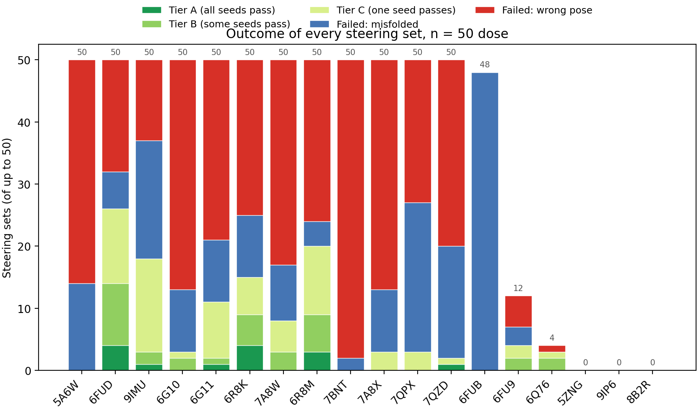
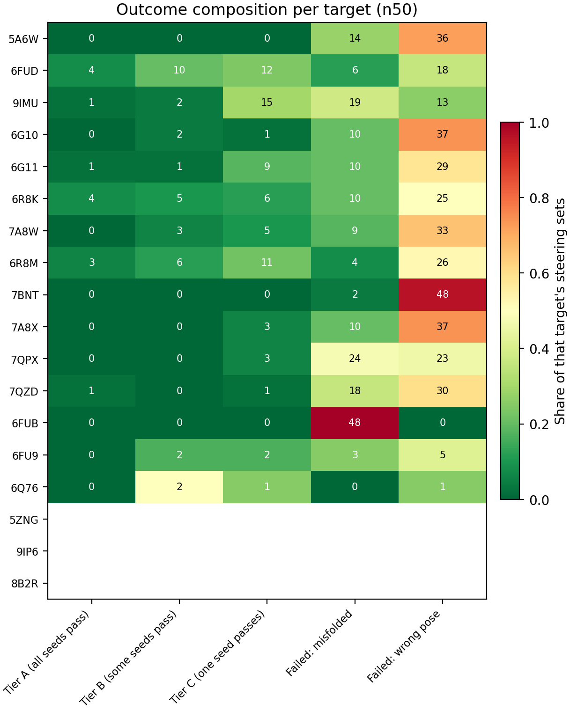
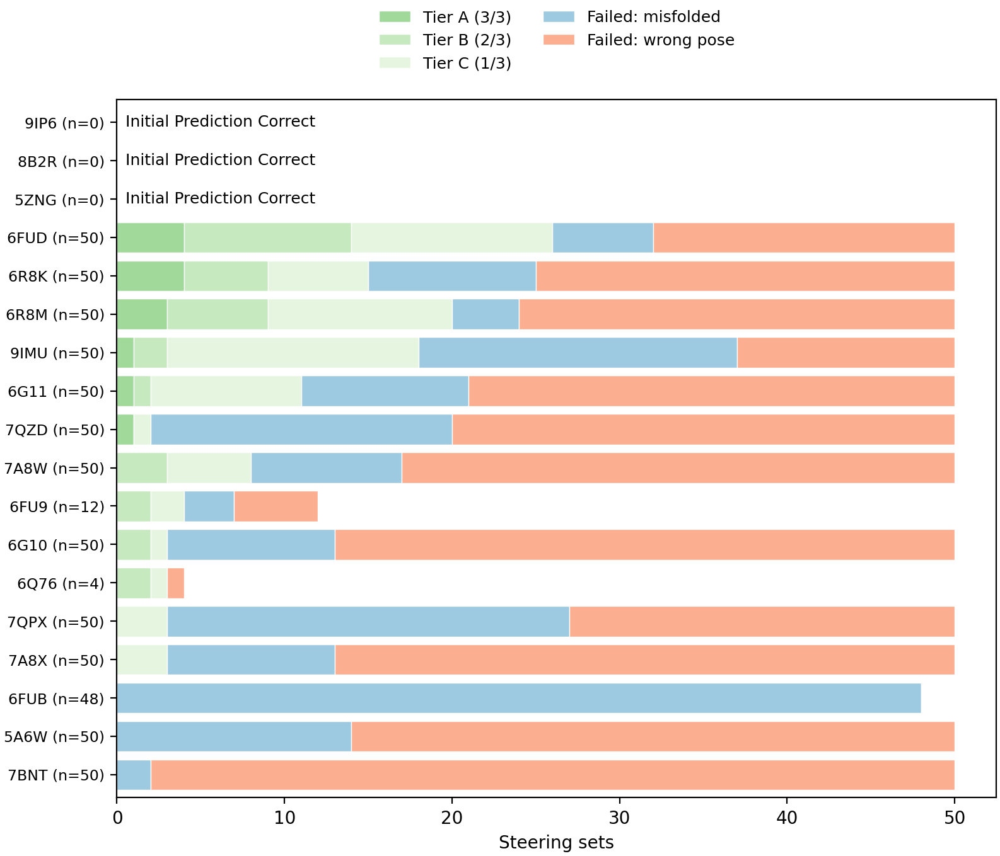

Date: 24/8/26

Every steering set in the n = 50 dose-sweep arm
(`experiments/dose-sweep/n50/`) is classified, for each of the 18 benchmark
targets. Tier A is all three seeds passing, B is two, and C is one. A set
that passed on no seed failed in one of two ways. Misfolded means a chain
sat more than 5 Å from its own reference on at least one seed, judged
independently of the other chain. Wrong pose means every seed folded
correctly but the effector never came within 5 Å of the true interface.

Three targets have no steering sets at all. 5ZNG, 9IP6 and 8B2R passed on
all three cold-start seeds, so steering never triggered.

Regenerate with:

```bash
python3 analyses/08-tier-failure-breakdown/tier_failure_breakdown.py
python3 analyses/08-tier-failure-breakdown/make_plots.py
```

One data-quality point affects how these counts are read. On most
no-reversion rows the n50 run tree leaves
`steered_n_contacts_on_mutated_positions` blank rather than writing an
explicit 0. The shipped 20-set benchmark always writes the 0. Read
literally, blank looks like missing data and drops those seeds silently.

`tier_failure_breakdown.py` treats blank and 0 the same, which is the right
read, because the two never appear alongside a real non-zero value in clean
data. `make_plots.py`'s `select_representative()` does not carry that fix.
It is used elsewhere in this repo, including for
`dose_sweep_pass_counts.csv`, so on this run tree specifically it can
undercount seeds and overstate a design's tier.

```{python}
from pathlib import Path
import pandas as pd

HERE = Path.cwd()
if not (HERE / "tier_failure_breakdown_n50.csv").exists():
    HERE = Path("analyses/08-tier-failure-breakdown")

df = pd.read_csv(HERE / "tier_failure_breakdown_n50.csv")
df
```

## Three ways to show it

### 1. Stacked counts, ordered by n_sets

{width="100%"}

- Raw counts keep the varying denominator visible. 6Q76 stops at 4 sets,
  having saturated its mutation-set pool, where most targets ran the full 50.
- Wrong pose is the larger failure mode across the cohort, at 361 sets
  against 187 misfolded. 6FUB is the exception, misfolding on all 48.

### 2. Heatmap, share of each target's own sets

{width="70%"}

- Normalising lets one target's composition be read without the eye
  rescaling bar heights first.
- 6FUB is 48 of 48 misfolded and none wrong-posed, which no other target
  comes close to. 7QPX is the next highest at 24 of 50.

### 3. Raw counts, ranked by rescued-set count (thesis figure)

{width="100%"}

- Ranking by rescued-set count puts the targets steering actually moved at
  one end and the targets it never moved at the other, which is the
  comparison the thesis figure is making.
- 6Q76 has the highest rescue fraction of any target, 3 of 4 sets. It is
  also the least supported point here, because 4 sets is the whole sample.

## Summary

```{python}
d = df[df["n_sets"] > 0].copy()
d["rescue_frac"] = (d["A"] + d["B"] + d["C"]) / d["n_sets"]
print(f"Targets with >=1 steering set: {len(d)} / {len(df)}")
print(f"Targets with >=1 Tier A design: {(d['A'] > 0).sum()} / {len(d)}")
print(f"Median rescue fraction (A+B+C / n_sets): {d['rescue_frac'].median():.2f}")
print(f"Misfolding share of all failures: "
      f"{d['failed_misfolded'].sum() / (d['failed_misfolded'].sum() + d['failed_wrong_pose'].sum()):.2f}")
```

- Wrong pose is the dominant failure mode overall, at 66% of failed sets.
  Misfolding is not rare, and it concentrates rather than spreading evenly.
  6FUB, 7QPX and 9IMU carry 91 of the 187 misfolded sets between them.
