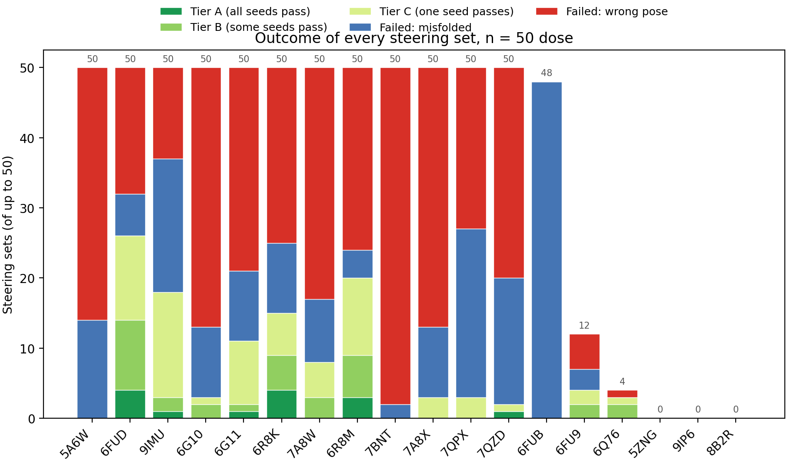
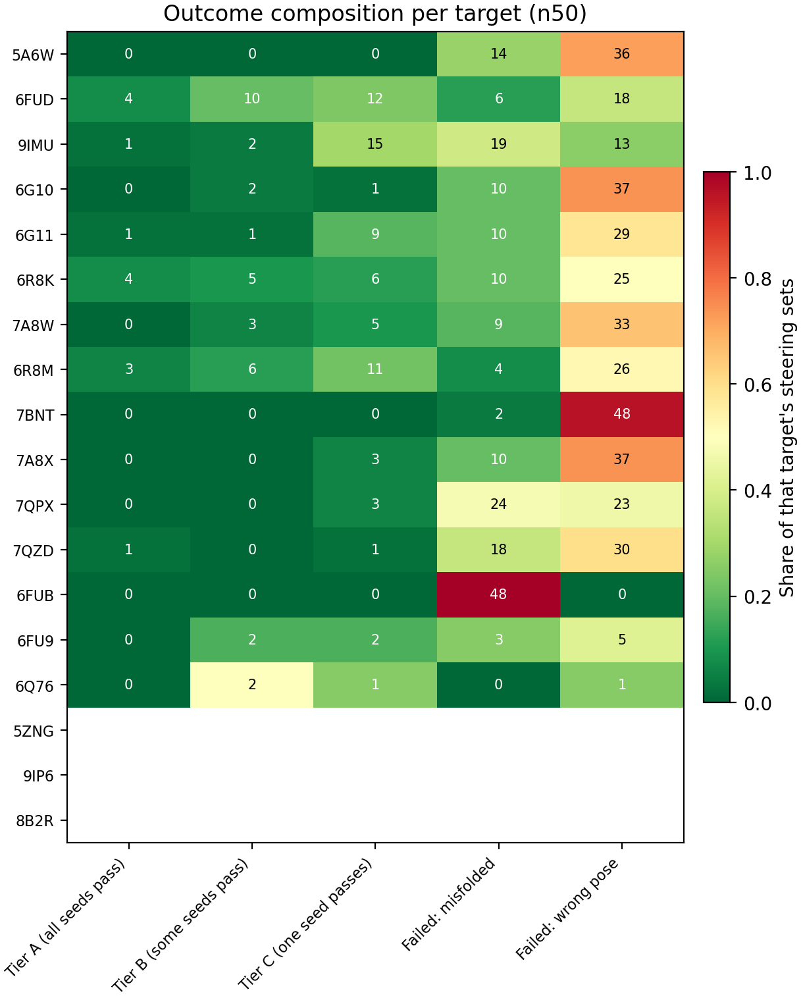
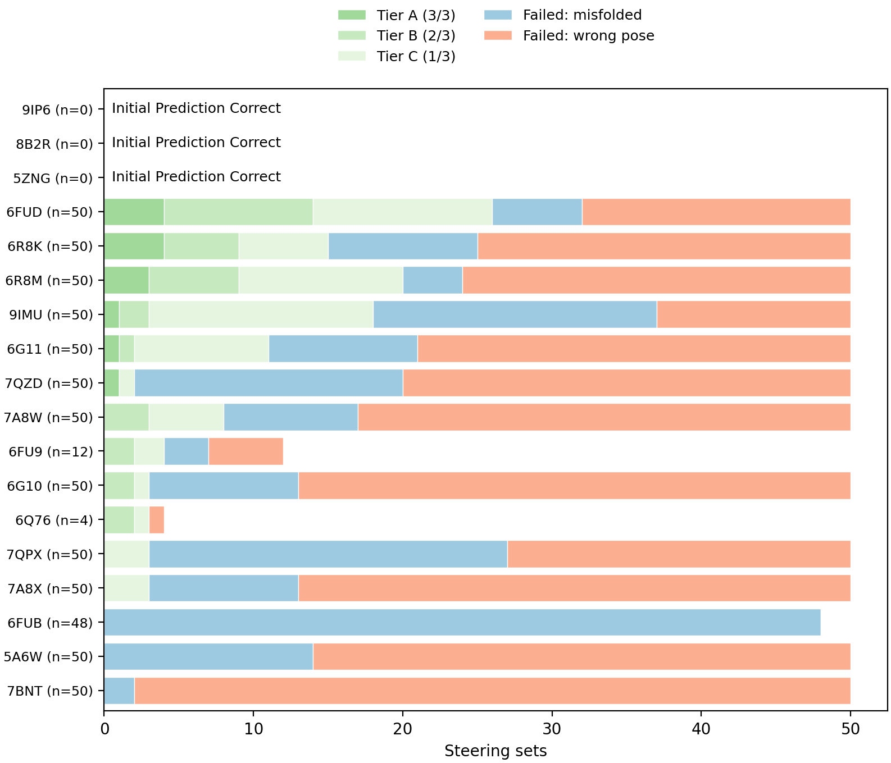

Date: 24/8/26

For each of the 18 benchmark targets, every steering set in the n = 50
dose-sweep arm (`experiments/dose-sweep/n50/`) is classified into Tier A
(all 3 seeds pass), B (some pass), C (one passes), or one of two failure
modes: misfolded (a chain independently >5 Å from its own reference on at
least one seed) or wrong pose (every seed folds correctly but the effector
never reaches <5 Å of the true interface). Three targets (5ZNG, 9IP6, 8B2R)
have 0 steering sets because their cold start already passed on all 3 seeds,
so steering was never triggered.

Regenerate with:

```bash
python3 analysis/08-tier-failure-breakdown/tier_failure_breakdown.py
python3 analysis/08-tier-failure-breakdown/make_plots.py
```

Data-quality note: the n50 run tree leaves
`steered_n_contacts_on_mutated_positions` blank rather than an explicit 0 on
most no-reversion rows (unlike the shipped 20-set benchmark, where it is
always 0 there). Read literally that looks like missing data and silently
drops those seeds. `tier_failure_breakdown.py` treats blank the same as 0
(the two never coexist with a real non-zero value in the clean data), which
is the right read but is worth flagging: `make_plots.py`'s own
`select_representative()` (used elsewhere in this repo, including
`dose_sweep_pass_counts.csv`) does not carry this fix, so it can undercount
seeds and inflate a design's apparent tier on this run tree specifically.

```{python}
from pathlib import Path
import pandas as pd

HERE = Path.cwd()
if not (HERE / "tier_failure_breakdown_n50.csv").exists():
    HERE = Path("analysis/08-tier-failure-breakdown")

df = pd.read_csv(HERE / "tier_failure_breakdown_n50.csv")
df
```

## Three ways to show it

### 1. Stacked counts, ordered by n_sets

{width="100%"}

- Raw counts keep the varying denominator visible (6Q76 stops at 4 sets,
  having saturated its mutation-set pool; most others ran the full 50).
- Wrong-pose failure dominates the top few targets; misfolding dominates
  6FUB almost entirely.

### 2. Heatmap, share of each target's own sets

{width="70%"}

- Best for spotting which failure mode dominates a specific target at a
  glance, without the eye needing to rescale bar heights first.
- 6FUB stands out as 100% misfolded, a distinct failure signature from every
  other target here.

### 3. Raw counts, ranked by rescued-set count (thesis figure)

{width="100%"}

- Best for comparing rescue rate itself across targets, since every bar
  reaches 100% regardless of n_sets.
- 6Q76 has the best rescue rate of any target shown, but only from 4 sets
  total, so it is the least statistically supported point on this chart.

## Summary

```{python}
d = df[df["n_sets"] > 0].copy()
d["rescue_frac"] = (d["A"] + d["B"] + d["C"]) / d["n_sets"]
print(f"Targets with >=1 steering set: {len(d)} / {len(df)}")
print(f"Targets with >=1 Tier A design: {(d['A'] > 0).sum()} / {len(d)}")
print(f"Median rescue fraction (A+B+C / n_sets): {d['rescue_frac'].median():.2f}")
print(f"Misfolding share of all failures: "
      f"{d['failed_misfolded'].sum() / (d['failed_misfolded'].sum() + d['failed_wrong_pose'].sum()):.2f}")
```

- Wrong pose is the dominant failure mode overall, but misfolding is not
  negligible and is concentrated on a few targets (6FUB, 7QPX, 9IMU) rather
  than spread evenly.
