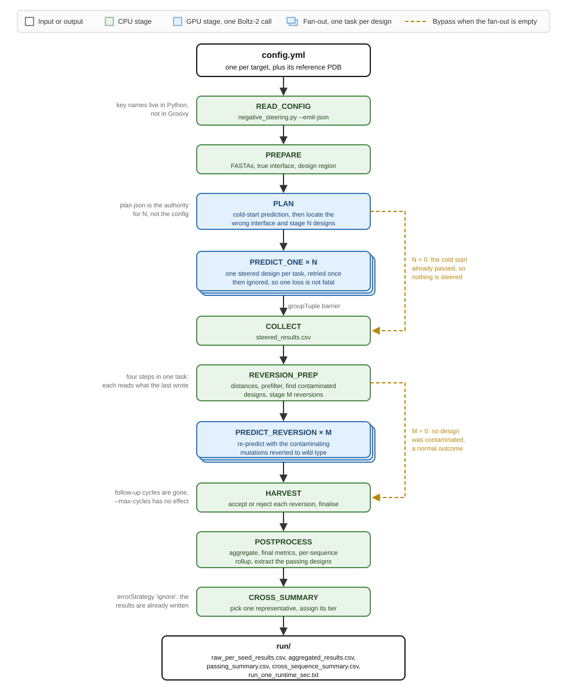

# Implementation notes

The detail that used to sit in the README. It is here rather than deleted
because every entry records a decision that cost something to learn, but none
of it is needed to run the pipeline or read the results. Start from the
[README](../README.md).

## How it runs



`tests/test_smoke.py` holds this figure to the code. It asserts the processes
drawn here are exactly the processes `modules/negsteer_stages.nf` defines, so a
stage added or renamed without redrawing fails the suite. A figure that has
drifted from the code is worse than no figure, because it is still believed.

The method the workflow runs is a separate figure, under
[What it measures](#what-it-measures).

One target is one `config.yml`. The two fan-outs, one Boltz-2 call per steered design and one per reverted design, were bash loops inside a single SLURM job. They are Nextflow channels now, so each prediction is a task with its own resources, retry and failure. The width of each fan-out is read from the stage before it rather than from the config. The plan legitimately stages fewer designs than asked, or none at all when the cold start already passes.

Each stage writes its elapsed seconds to its own file under `run/.stage_times.d/`, and `POSTPROCESS` concatenates that directory into `run/.stage_times` and sums it into `run_one_runtime_sec.txt`. One file per stage rather than one shared file, because the two fan-outs append concurrently from different nodes over a shared filesystem. The first real cluster run lost one of nine `predict_one` lines that way, which silently understates the cost. Concatenating at the end is also idempotent, so a `-resume` that re-runs `POSTPROCESS` cannot double-count. That is the per-run cost the compute-cost analysis reads. It is a sum rather than a wall-clock, because the single job it replaced ran the stages in sequence, and the sum is what stays comparable with the committed benchmark.

## Design decisions

**`bin/` and `modules/` are owned here.** They started as a copy of the pipeline's negative-steering entry points and their import closure. They have since diverged and are no longer kept in step with it. Changes made here do not flow back to the pipeline, and pipeline changes do not flow in.

**Follow-up cycles are gone, not switched off.** A cycle was a second round of negative steering on the first round's survivors. Cycle N+1 started from a parent's already-mutated receptor sequence and added more mutations at positions earlier cycles had not touched. `total_mutations` is the Hamming distance from the wild type, so it compounded per cycle. That is why follow-up cycles were abandoned. A design carrying several cycles of edits is no longer a plausible construct. The harness that submitted the next cycle with `sbatch`, and the code that read such a run, are not in this repository: they are kept outside it, in a gitignored `archive/`, as the only record of the multi-cycle design. What went with them was the pathway discovery and row builder in `cmd_aggregate`, the ancestry walk in `_populate_reverted_mutations`, and the dotted label scheme. `bin/pathway_labels.py` survives under that name but holds different code now, the mutation-table reader and Boltz sidecar lookup that `reversion.py` and `negsteer_aggregate.py` import. No run ever produced a cycle-1 row: all 110 `all_results_multicycle.csv` files on disk carry `cycle=0` across 4,644 rows, and every one of the 108 cycle directories in the benchmark tree is `cycle_0`. `negsteer_aggregate.py` now refuses an experiment root containing a `cycle_N` directory rather than writing a table that omits its rows. Re-enabling cycles means wiring them as channels in `main.nf`, not letting Python call the scheduler from inside a task.

**Every process declares a `path` output, including the ones whose result is a value.** Nextflow hashes file content to decide what `-resume` may skip. A process that emits only `val` gives it nothing to hash, and a resumed run silently repeats hours of GPU work. Each stage therefore copies its artefact into the task directory and declares it.

**A run resumes rather than restarting.** `cmd_predict_one` skips a design whose prediction already exists, so a job that hits the SLURM walltime mid-sweep can be resubmitted without discarding completed work. The full experimental complexes here run up to ~1400 residues, which the pipeline's short design fragments never do. The guard confirms the on-disk `prediction.pdb` receptor sequence still matches the design's `receptor.fasta` before skipping, and recomputes on any mismatch, so it cannot reuse a stale prediction. Design sampling is seeded and design directories are created with `exist_ok=True`, so a re-run reproduces the same designs.

**The design region is protected, not targeted.** Negative steering does not mutate the interface to break binding. It mutates surface residues the *predicted* structure wrongly places in contact, excluding a protected set that always contains the true interface and, under `design_region_union`, the design region as well. In the full pipeline that region is the RFDiffusion de-novo stretch being validated, which must stay untouched so the rescue pose is not contaminated.

**A native solved complex is a sanity case, not the normal input.** It has no de-novo region, so the default is `design_region: none` with `negsteer_protected_set_source: true_interface`. A native complex already binds at its true interface, so the predicted wrong interface overlaps the true one heavily. The engine detects this almost-already-correct regime, gentles the mutation count, and leans on its second-shell fallback of residues near but not at the protected interface. To steer a designed sequence instead, point `reference_pdb` at the design and set `design_region` to the de-novo stretch with `negsteer_protected_set_source: design_region_union`.

**Negative steering is not blind to the intended interface.** The *wrong* interface is read off the prediction alone, so that half needs no answer. The protected set is different. Every `negsteer_protected_set_source` includes the true interface. `design_region_union` is the true interface together with the design region, not the design region alone. The residues the engine may mutate are therefore always the predicted contacts minus a truth-derived set. The method is never told where to bind. It is told where not to break.

That is a weaker requirement than a restraint, and a different one. A restraint needs the answer. The protected set needs an interface you already intend to keep, which on a grafted or designed receptor is known by construction rather than by having solved the structure. The motivating case is a graft where the intended interface is deliberate and the predictor keeps settling elsewhere, and one mutation away from that site is what makes the prediction hold. On the native complexes benchmarked here the intended and true interfaces coincide, so these results are a proxy for that regime rather than evidence of a truth-free method. Quote them that way.

**Reference restraints are a ceiling, not a method.** `negsteer_boltz_constraints: true` appends the same Cα pocket and dense-contact block as `structure-prediction-benchmarking`'s `BOLTZ2_CONSTRAINED` process to every Boltz-2 call in the run. Those restraints are derived from the true interface, so they cannot run on a novel target. They show the failures are not intrinsic to Boltz-2.

**Per-run cost is set by `negsteer_n_designs`, per-prediction cost is not.** Benchmark wall-clock uses `standalone_elapsed_s`, not `elapsed_s`, so the shared ColabFold MSA search is charged to the models that depend on it. Using `elapsed_s` understates Boltz-1 MSA, Boltz-2 MSA and ColabFold by roughly 35 min each and inverts the per-prediction conclusion.

## Using it as a tool

`negsteer` is the interface another pipeline calls, in the same way it calls RFDiffusion or ProteinMPNN. One command, one run directory.

```bash
singularity exec --nv negsteer.img negsteer run \
    --name            design_00 \
    --receptor-fasta  receptor.fasta \
    --effector-fasta  effector.fasta \
    --reference-pdb   complex.pdb \
    --design-region   design_region.txt \
    --true-interface  true_interface.txt \
    --outdir          design_00
```

Everything else has a default. `--n-designs`, `--num-seeds`, `--diffusion-samples`, `--recycling-steps` and `--boltz-constraints` cover the usual knobs, and `--plan-extra-args` forwards anything else to the engine verbatim so the CLI never becomes a bottleneck. A knob you do not set is not forwarded, so the engine's own default applies rather than this CLI restating it.

**Read `negsteer_result.json`, do not glob the directory.** It names every output, reports whether each one exists, and carries a `contract_version` to pin against. Files not named in it are internals and may move.

```json
{
  "contract_version": 1,
  "name": "design_00",
  "status": "ok",
  "skip_steering": false,
  "n_designs_planned": 20,
  "n_reversions_planned": 3,
  "tiering_succeeded": true,
  "runtime_seconds": 6690,
  "outputs": {
    "per_seed_results": "raw_per_seed_results.csv",
    "aggregated_results": "aggregated_results.csv",
    "passing_summary": "passing_summary.csv",
    "cross_sequence_summary": "cross_sequence_summary.csv",
    "runtime_seconds": "run_one_runtime_sec.txt"
  }
}
```

`status` is `skipped_steering` when the cold start already passed, which is a normal outcome and not a failure. `tiering_succeeded: false` means the run produced its results but the representative could not be picked, which is also not a failure.

The CLI runs the same stages, in the same order, with the same arguments as `bin/negative_steering_run_one.sh`, which produced the committed benchmark. Thirteen invocations always run, plus one `predict-one` per steered design and one `predict-reversion-one` per reversion. `tests/characterization/test_negsteer_cli.py` holds that list as `EXPECTED_STAGES` and asserts the equivalence, so the tool and the runner behind the published numbers cannot drift apart.

Nesting is not a problem. The engine detects `SINGULARITY_NAME` and calls `boltz` directly when it is already inside a container. That is why `negsteer` runs in-container where the old shell orchestrator could not. `--boltz-container` is only needed on a bare host.

Until the image is rebuilt from `containers/Dockerfile`, reach the same CLI from a bind-mounted checkout:

```bash
singularity exec --nv --bind $REPO negsteer.img \
    env PYTHONPATH=$REPO python -m negsteer.cli run ...
```

## Running it

The engine is a mid-pipeline component. It does not turn a bare PDB into results by itself. It needs both chain sequences plus a true-interface and a design-region index file, and it uses the complex as the comparison basis. Runs are config-driven, one YAML per target.

The HPC is airgapped, so nothing is installed there and everything runs in a container. `negative_steering.slurm.sh` uses only `bash`, `grep` and `singularity` on the host, and the workflow's stages hold to the same rule. All Python runs inside the Boltz image, which ships `yaml`, `gemmi`, `biopython` and `numpy`. The GPU allocation is required or Boltz fails with "No supported gpu backend found!".

`tests/characterization/test_no_host_python.py` enforces that. Every `script:` block's Python must be wrapped in `singularity exec`, and every `stub:` block must need no container at all. The first cluster run failed on the one stage that broke the rule, `NEGSTEER_READ_CONFIG`, which called the host's `python3` for a driver that needs PyYAML.

That stage is the awkward one, because the container path is what it is reading. `bin/resolve_boltz_container.sh` pulls `boltz_container:` out of the YAML as plain text, the same extraction `negative_steering.slurm.sh` has always used, and the driver then runs inside that image. A config with no container is a hard error rather than a fallback. `--allow_host_python` opens the one exception, for CI, which has PyYAML installed and no image to run anything inside.

**The engine and the targets are two directories, not one.** `--targets`
resolves against the directory Nextflow was launched from, and each target's
`inputs/` and `run/` tree is written beside its own `config.yml`, so the
targets can live in another repository. Two things follow. The launcher takes
`NEGSTEER_REPO_DIR` for the engine and `NEGSTEER_LAUNCH_DIR` for where to run,
defaulting both to the submission directory, and it invokes
`${REPO_DIR}/main.nf` by absolute path. And every stage's `singularity exec`
binds more than the engine: `negsteerBinds()` in `modules/negsteer_stages.nf`
binds `params.repo_root` so the stage can run `bin/`, plus
`params.bind_paths`, which defaults to `launchDir` and is overridable with
`NEGSTEER_BIND_PATHS`. A container sees only what is bound, so a config or a
`reference_pdb` outside both would not exist inside the image.
`negsteerBinds()` drops a path already covered by an ancestor, and normalises
rather than canonicalises, because resolving a symlinked home would bind a
path the configs never name.

`tests/characterization/test_no_host_python.py` asserts every `singularity
exec` in the module goes through that helper, since a hand-written
`--bind ${params.repo_root}` would work in this checkout and fail only once the
targets moved out of it.

`main.nf` is the entry point. It takes a glob, so one target and the whole benchmark are the same command. `scripts/run_workflow.slurm.sh` submits it. The Nextflow head process is CPU-only, and it parses the DAG, submits each stage to SLURM and then waits, so it runs as a batch job rather than on the login node.

```bash
# on the HPC, from the repo root. One sbatch, nothing on the login node.
./scripts/submit.sh workflow tests/test_run/config.yml
./scripts/submit.sh workflow 'my_targets/**/config.yml'

# The header is a default and sbatch's own flags override it. Trim with care:
# the head job being killed at its walltime orphans whatever it has already
# submitted, so leave room for the GPU queue rather than for the work alone.
sbatch -t 12:00:00 scripts/run_workflow.slurm.sh tests/test_run/config.yml

# on a laptop, no container and no GPU:
nextflow run main.nf -profile local --targets '...' -stub-run   # walk the DAG
```

The wrapper resolves the JDK and the Nextflow launcher itself. Nothing is installed on the cluster. It extracts the launcher from `NextFlow.img` into this repo's own `nxf_home/` on first use, rather than borrowing a sibling repo's, so a run here cannot write into that one. `NEGSTEER_JAVA_HOME` and `NEGSTEER_NEXTFLOW_IMG` override both paths.

The head process is the one thing that does not run in a container. Its whole job is to submit and poll SLURM jobs, and `sbatch` and `squeue` are host binaries, so inside an image it would have no scheduler to talk to. That is why it needs a host JVM, which `NEGSTEER_JAVA_HOME` in `site.conf` points at, or any `java` already on PATH. The Nextflow version is not a host version either. The launcher is extracted from `NEGSTEER_NEXTFLOW_IMG`, whose own `%post` pins 25.10.4 by URL, and the host supplies only the JVM to run it. Install Nextflow 25.10.4 normally instead and `run_workflow.slurm.sh` uses that. Every pipeline stage still runs inside the Boltz image.

`-resume` is always passed, so a head job that hits its walltime can be resubmitted with the identical command and skips what already finished.

**Profiles here are shaped around a Nextflow version trap.** 25.10.x *replaces* a `withLabel:` block when a profile redefines the same selector, where 26.04 merges it. The cluster runs 25.10.4. An `hpc` profile that set `withLabel: gpu { executor = 'slurm' }` therefore reduced the gpu label to exactly that, dropping `queue`, `cpus`, `memory`, `time` and `clusterOptions`. Nextflow submitted a bare `sbatch`, SLURM placed the job on whatever partition it liked with one CPU and no GPU, and Boltz died with "No supported gpu backend found!". A laptop check on 26.04 could not see it.

So the cluster directives live in the `process` block, `hpc` sets only `process.executor` and touches no selector, and `local` is complete in itself. There is deliberately no profile named `standard`, because Nextflow applies that one whenever `-profile` is omitted. `tests/test_nextflow_profiles.py` holds that structure, and CI resolves the config with the cluster's own pinned Nextflow twice: once with partition names in the environment, asserting they arrive, and once with nothing set, asserting the queue resolves to null so Nextflow omits `-p` rather than submitting `-p null`.

Every run artefact lands in `.nextflow-reports/`. That is the trace the compute-cost analysis reads, the HTML report and timeline, and the log. The config places the first three. The log is chosen before the config is read, so it needs `NXF_LOG_FILE`, which the submit wrapper exports, or `nextflow -log .nextflow-reports/nextflow.log run ...` on a hand-rolled invocation. Without either, Nextflow drops `.nextflow.log` in whatever directory you launched from. `.nextflow/` is Nextflow's own state directory and cannot be moved; it is hidden and gitignored.

`tests/test_run/config.yml` drives this path too. It is the same file the single-run test uses, described under Tests below, so the workflow and the engine CLI are compared on identical inputs.

`-stub-run` checks the wiring on a laptop in seconds, with no container and no GPU. Every stage has a stub that writes a plausible artefact, so the channel shapes, the two fan-outs and both empty-fan-out bypasses are all exercised.

The trace, report and timeline are written on every run. `trace.txt` is what the compute-cost analysis reads.

A single target can still be run without Nextflow, which is useful when debugging one config. This is the runner that produced the 18-target benchmarking cohort. The 90-unit dose sweep was run by the workflow, and the two cohorts between them account for every committed result that came from this engine. The analyses repository records which produced what.

```bash
./scripts/submit.sh steer tests/test_run/config.yml

# CPU-only steps need no GPU node. Run them interactively with bash:
bash scripts/negative_steering.slurm.sh <config> --dry-run
bash scripts/negative_steering.slurm.sh <config> --prepare-only
```

`scripts/submit_benchmarks.sh`, which wrapped that runner for the whole
benchmark with one `sbatch` per target, moved to the analyses repository with
the benchmark itself.

On the Mac the Python driver runs the CPU-only steps directly, for prepping and inspecting.

```bash
pip install -e '.[runtime]'                 # numpy, gemmi, biopython, pyyaml
./bin/negative_steering.py <config> --dry-run
./bin/negative_steering.py <config> --prepare-only
```

The run splits across the container boundary. `negative_steering.py` runs inside the Boltz image, because that is where Python lives. It parses the config, calls `prepare_complex_inputs.py` to derive the FASTAs, interface and design region, then writes `run/launch.sh` with every engine argument already resolved. `negative_steering.slurm.sh` executes that on the host, because the engine orchestrator does its own `singularity exec --nv` and singularity cannot be nested. It then assigns the run's tier. `launch.sh` doubles as the record of exactly what ran.

The container comes from `--container /path/to.img`, then the config's `boltz_container:`, then `NEGSTEER_BOLTZ_IMG` in `site.conf`. A config that leaves the key null resolves to the site setting.

### Driving the two steps by hand

The config driver is the supported path. `prepare_complex_inputs.py` also runs on its own, for deriving inputs for something that has no `config.yml`.

```bash
./bin/prepare_complex_inputs.py \
    --complex data/reference_complexes/6G10.pdb \
    --outdir  /tmp/6G10/inputs \
    --derive --contact-cutoff 5.0
```

Prepare writes `receptor.fasta`, `effector.fasta`, `true_interface.txt` and `design_region.txt`. For 6G10 that is receptor chain A at 76 residues, effector chain B at 83, and 26 interface residues at 5 Å.

The interface is either derived from heavy-atom contacts with `--derive --contact-cutoff`, or supplied with `--interface-file`. Chains default to receptor A and effector B, overridden with `--receptor-chain` and `--effector-chain`. The design region takes `--design-region none|all` or `--design-region-file FILE`.

**The two residue files use different index bases.** `--interface-file` takes 0-based positional indices, one per line or comma-separated, with `#` comments ignored. `--design-region-file` takes a 1-based list.

## Tests

Two tiers, one marker each. A marker says what a test needs, not where it happens to run.

| Tier | Needs | Covers |
|:---|:---|:---|
| `logic` | Python and the `test` extra | pure helpers on synthetic input, plus the committed fixtures and the two reference structures |
| `check_test_run` | the output of a real run | a finished run tree on disk |

```bash
pip install -e '.[test]'
pytest -m logic                  # everything that needs no run
pytest                           # adds check_test_run, against a run already on disk
./scripts/submit.sh test-run     # produce a fresh run, then assert on it
```

### The single-run test

`tests/test_run.slurm.sh` runs the engine end to end on a GPU
node and then asserts on what it produced. It is the only test that runs the
plan and collect stages of `boltz2_negative_steering`, and the contamination
and reversion harvest in `reversion`, against a real Boltz prediction. The
laptop tier reaches the same code with the prediction stubbed, which is why
those modules are no longer the coverage gap they once were.

`tests/test_run/config.yml` is the shipped 6G10 benchmark configuration with
one knob turned down, `negsteer_n_designs` at 3 rather than 20. The fan-out is
then 3 designs by 3 seeds, 9 prediction tasks instead of 60. 6G10 was chosen
because its cold start fails badly, 23.9 Å against the 5 Å threshold, so the
plan stages designs and the steering fan-out actually runs.

It does NOT exercise the reversion fan-out, and an earlier version of this
paragraph said it did. The 4-of-6 contamination figure behind that claim is
from the 20-design `experiments/benchmarking/` run, not from this config.
Contamination is only checked on designs that pass the RMSD gate, and in the
cluster run of 2026-11-27 none of the nine did, so `build-contaminated`
reported 0 checked and `plan-reversions` wrote an empty plan. What this config
covers instead is the empty-fan-out bypass, on real hardware rather than only
under CI's stub run.

One config drives both entry points, the Nextflow workflow and the engine CLI,
so the two paths are compared on identical inputs and neither can lose coverage
to the other.

It is not a benchmark configuration and its numbers must never be pooled with
the benchmark in the analyses repository.

The assertions deliberately do not check the pose. Three designs by three
seeds is far too little sampling to expect a rescue, where the benchmark's
15-of-18 came from 50 mutation sets per target, and asserting `ra_eff` improved
would make the test flaky for reasons unrelated to whether the engine works.
What is checked is that every stage ran and wrote what it promises, that the
counts match the config, which the assertions read from `config.yml` rather
than restate, and one real invariant: that steering never mutated a
residue in the protected true interface. Steering that mutated the binding site
would be destroying it rather than removing a competitor, and every downstream
number would still look plausible.

Validate the config on a laptop first, which needs no GPU:

```bash
./bin/negative_steering.py tests/test_run/config.yml --prepare-only
```

`bin/` used to carry a tiered object model ported from
`receptor-resurfacing-pipeline`, eleven modules built around one MPNN sequence
per RFDiffusion backbone, with eleven test files ported alongside them. A run
here is one solved complex with one sequence, nothing constructed any of those
classes on a workflow path, and `cross_summary_cli.py` wrapped
`cross_summary.py` to produce a byte-identical CSV. All of it went, along with
the RFDiffusion contig parsing and the two `derive_*` scripts that read a
design pipeline's `rfdiffusion_metrics.json`. The pipeline keeps its own
copies, which is where that code belongs.

The `hpc` tier pins a finished benchmark run. It asserts both variants cover the
same targets, that every run carries the outputs it should, that one run yields
exactly one tiered representative, and that a run under `constrained/` really
did carry `--boltz-constraints`. That last one is the only thing that would
catch a run landing in the wrong variant directory, which would silently make
the comparison between them meaningless. The tier skips cleanly when no run tree
is present. Point it elsewhere with `NEGSTEER_BENCH_DIR`.

Two invariants worth naming, because both were wrong on the first attempt.
`summary.txt` is not written by every run, since a target whose cold start
already passed short-circuits before it. And `cross_tier` is assigned from
`passing_summary.csv`, so a tier-none row can still carry a non-zero
`rep_n_pass`. That block is filled by a best-of-a-bad-lot fallback from
`aggregated_results.csv` rather than by the passing gate.

The cross-summary chain is pinned by golden output. Four committed fixtures
reproduce real runs covering every tier, A, B, C and none, and the test asserts
every computed column matches, excluding only the two columns that record an
input path. The tier-none fixture carries the sibling `aggregated_results.csv`
the fallback reads, without which the representative block comes back empty
rather than failing.

`prepare_complex_inputs.py` is asserted against 6G10's known answer, receptor
chain A at 76 residues, effector B at 83, and 26 contacts at 5 Å.

The workflow itself is tested two ways. `-stub-run` walks the whole DAG with no
container and no GPU, which is what catches a broken channel shape. And
`tests/test_smoke.py` asserts that `main.nf` includes every process the module
defines, and that the workflow figure under How it runs still draws exactly
those processes with the GPU stages coloured as GPU stages.

Coverage runs on every invocation and is gated as a ratchet that may only rise.
`htmlcov/index.html` is the browsable report and `lcov.info` the machine-readable
one, both gitignored.
